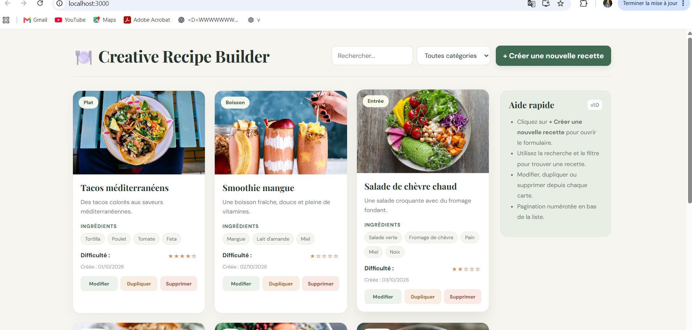
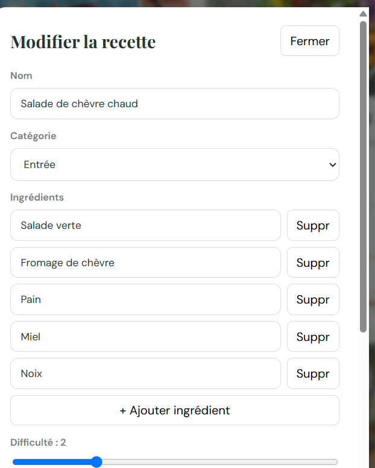
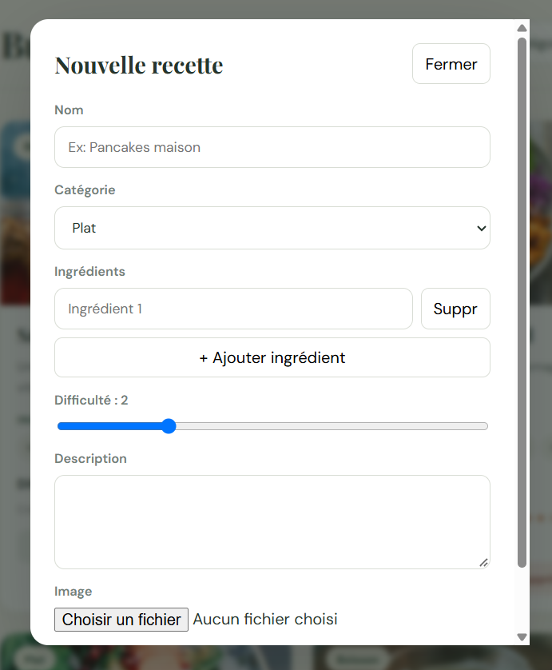

# Creative Recipe Builder

This project was bootstrapped with [Create React App](https://github.com/facebook/create-react-app).

## Screenshots

### Home Page

###  modifier Recipes Page 

### Recipe Form

## Available Scripts

### `npm start`

Runs the app in development mode.

Open [http://localhost:3000](http://localhost:3000) to view it in your browser.

The page will reload when you make changes.

### `npm test`

Launches the test runner in interactive watch mode.

### `npm run build`

Builds the app for production in the `build` folder.

## Learn More

- [Create React App Documentation](https://facebook.github.io/create-react-app/docs/getting-started)
- [React Documentation](https://react.dev/)